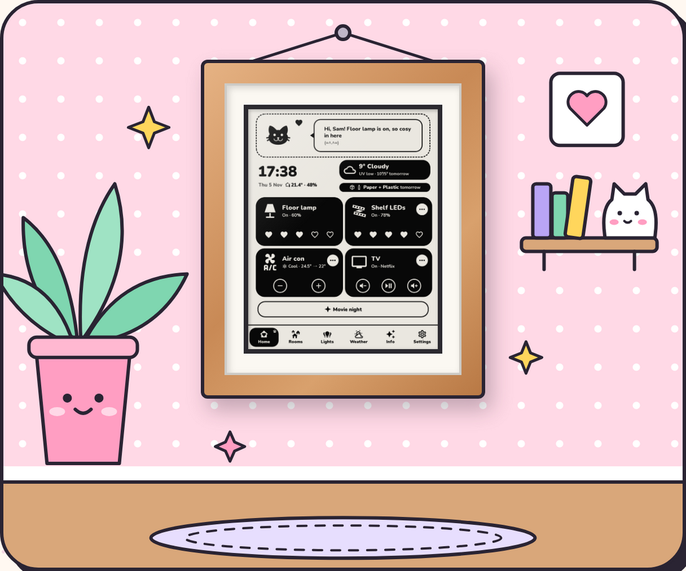
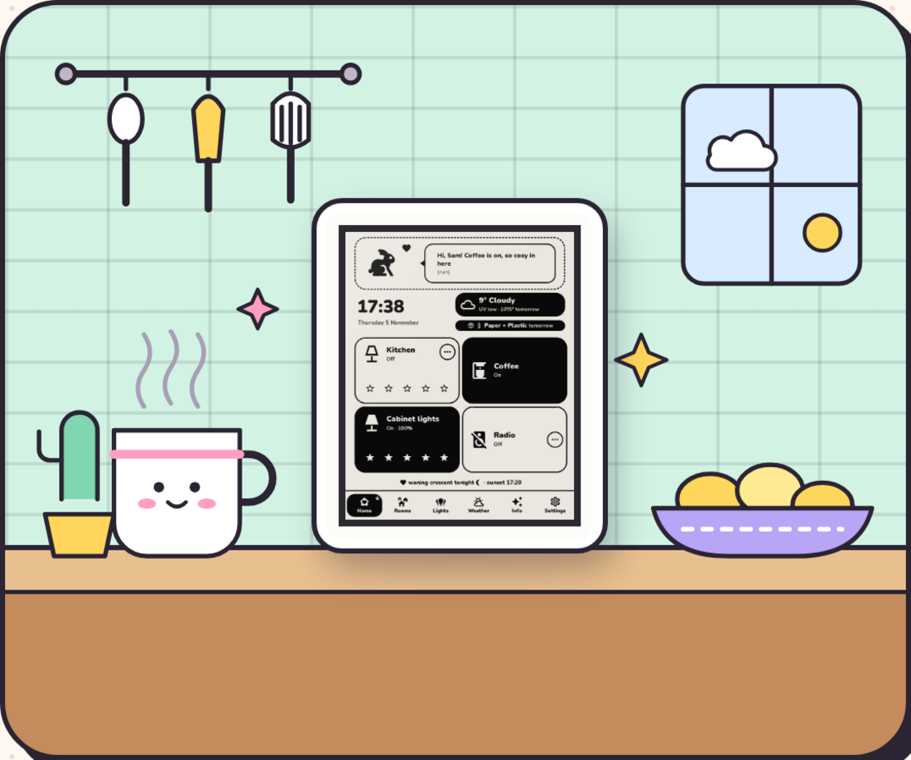
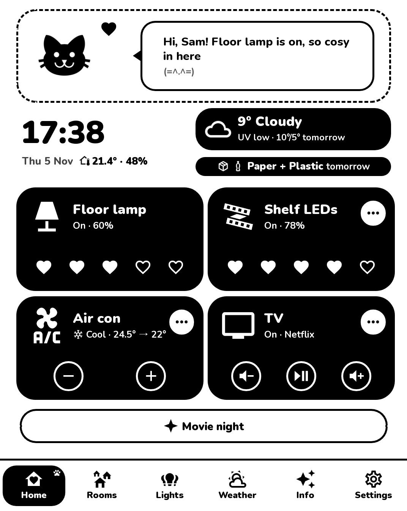
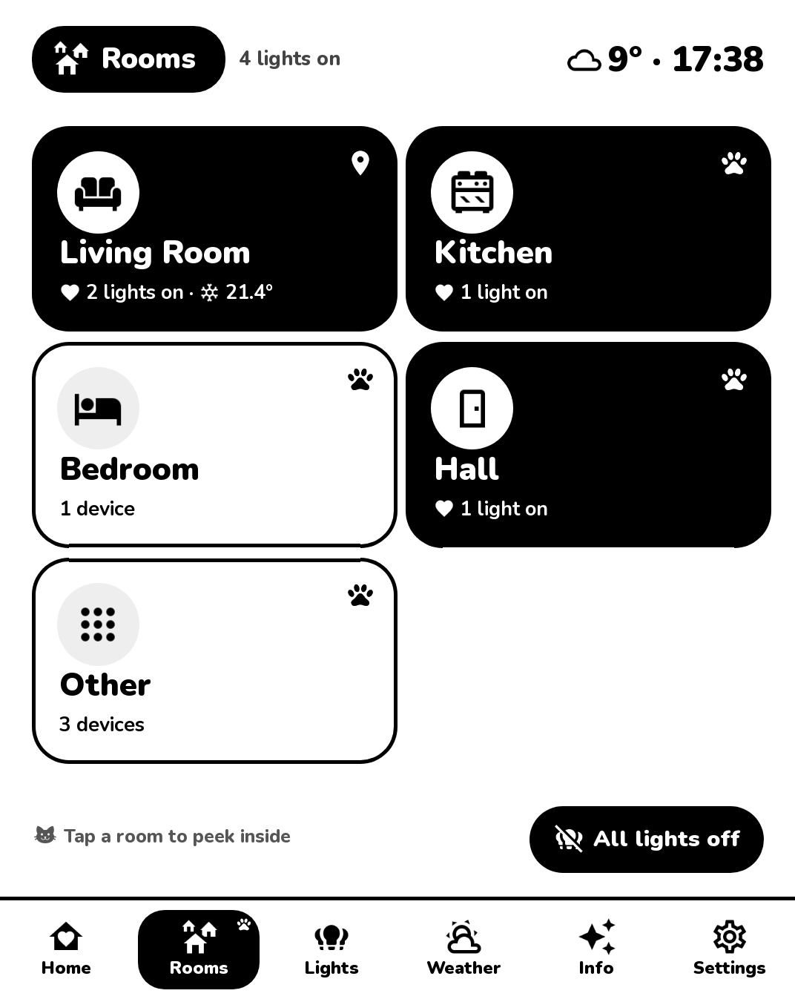
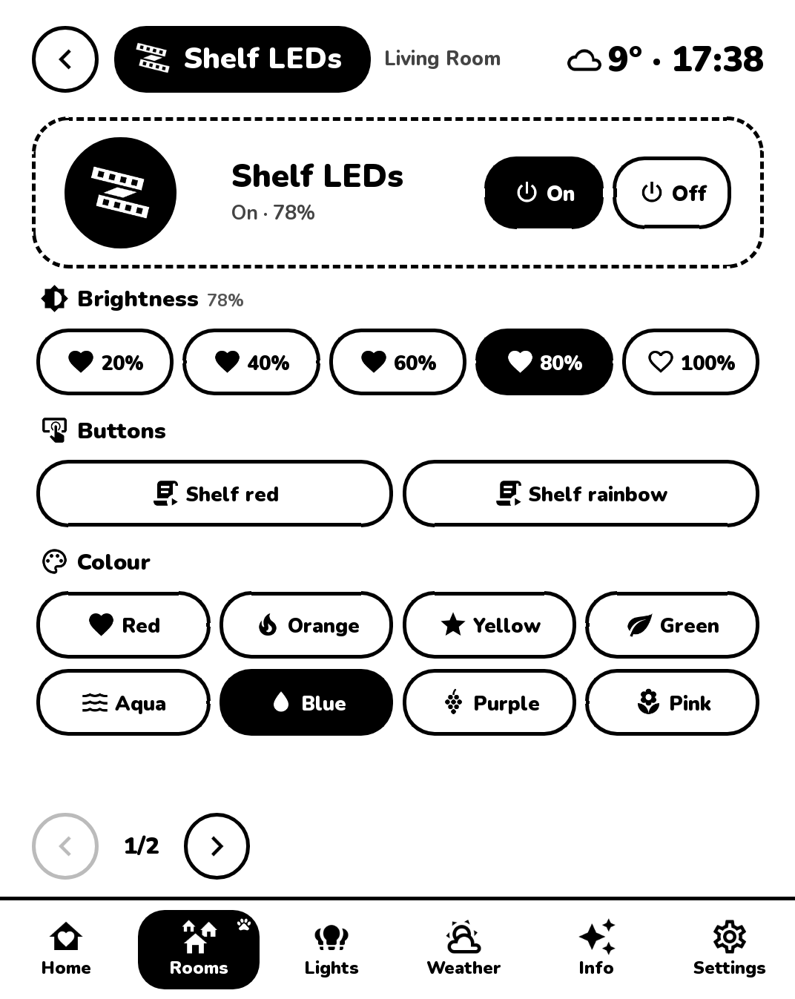

# PaperKiosk

**Home Assistant on an e-ink screen.** A calm, always-on control panel for lights, climate, TV and scenes, with
the weather, bin day, and a small pet that comments on it all. It runs as a KUAL extension, in any browser, or
behind another e-paper dashboard.

**Website and step-by-step guide:** https://cornilliej.github.io/PaperKiosk/

<p>


</p>

<p>



</p>

- Made for e-ink: black and white, one screen per page, only what changed is redrawn.
- Reads rooms and devices from Home Assistant; new devices wait for your approval.
- A settings page with a live preview: cards, nicknames, icons, pets, home styles, quiet hours, more screens.
- Locked down by default: paired screens, a settings password, no cross-site requests, locks and garage doors
  can't be opened unless you allow it. See [SECURITY.md](SECURITY.md).

## What you need

- A computer that is always on, with **Docker**: Linux, macOS, or Windows with WSL and Docker Desktop
  ([On Windows](https://cornilliej.github.io/PaperKiosk/install.html#windows)).
- **Home Assistant** on your network.
- A screen: a device that already runs **KUAL** (see [docs/kual.md](docs/kual.md)), any browser, or another
  e-paper dashboard that can load a URL.

## Install

```sh
git clone https://github.com/CornillieJ/PaperKiosk.git
cd PaperKiosk
./install.sh
```

Choose **Automatic** and it only asks what it can't know (a password, your Home Assistant token, the screen).
The steps:

1. checks Docker (and offers [gum](https://github.com/charmbracelet/gum) for menus),
2. configures the server: port, address, time zone, the kiosk key and the settings password,
3. connects to Home Assistant: finds it, explains the access token, tests it, asks the screen's room,
4. starts the server (`docker compose up -d`),
5. installs the KUAL extension over USB or Wi-Fi, or, for anything else, shows the link (nothing to install),
6. KUAL devices only: starts the kiosk (over Wi-Fi by itself, otherwise after one tap in KUAL).

Every step is also a script you can run on its own, any time:

| Script | What it does |
| --- | --- |
| `scripts/00-requirements.sh` | Checks Docker, Compose and tools; offers gum |
| `scripts/10-configure.sh` | `.env`, kiosk key, settings password (`--new-password`, `--new-key`) |
| `scripts/20-home-assistant.sh` | Home Assistant address, token, the kiosk's room |
| `scripts/30-start-server.sh` | Builds and (re)starts the server, prints the links |
| `scripts/40-kindle-install.sh` | Copies the Kindle app (USB, Wi-Fi or a folder to copy yourself) |
| `scripts/50-kindle-setup.sh` | Starts the kiosk on the Kindle and checks it works |
| `scripts/add-screen.sh` | Adds another screen (a second Kindle, a tablet, ...), optionally with its own room and cards |
| `scripts/update.sh` | Pulls the newest version, rebuilds, updates the Kindle app |

Unattended installs: `./install.sh --yes` with the answers as environment variables, for example
`ADMIN_PASSWORD=... HA_URL=http://192.168.1.20:8123 HA_TOKEN=... SCREEN=other ./install.sh --yes`
(the variable names are listed at the top of each script).

## Use

- **Settings:** `http://<server>:8100/config` from a PC or phone (log in with your password). A live preview of
  the screen sits on the right; drag the cards on Home to reorder them.
- **On the screen:** tap a card to switch it, the hearts for brightness, the round **…** for everything else.
  The Settings tab picks the home style, says where the kiosk hangs today, and has *Going to bed*.
- After a KUAL device restarts: *KUAL → PaperKiosk → Start kiosk*.
- **More screens:** `./install.sh --add-screen` (or just `./install.sh` once it's set up: it offers a menu).
  It installs the KUAL extension or shows the link (and a QR code with `qrencode`) for any other screen, waits until it
  pairs, and can give it its own room, cards and pet. Change those under *Screens* on the settings page.

## Files

```
docker-compose.yml   the server (built from ./server)
.env                 your settings for the server (made by the installer; see .env.example)
secrets/             Home Assistant token, kiosk key, password hash (never commit these)
ssh/                 the installer's SSH key for KUAL devices (kept out of the server container)
data/config.json     the dashboard's settings (what you change on /config)
server/              the Python server and its tests
kindle/extension/    the KUAL extension
kindle/tools/        screenshot / tap / open-a-page helpers for a KUAL device over SSH
scripts/             the install steps
docs/                KUAL notes, troubleshooting, development
```

## More

- [docs/kual.md](docs/kual.md): the KUAL extension, SSH, notes on the web engine
- [docs/troubleshooting.md](docs/troubleshooting.md): when something doesn't work
- [docs/development.md](docs/development.md): how it is built, tests, the demo server
- [SECURITY.md](SECURITY.md): what PaperKiosk protects, and what you should do

By CornillieJ · MIT licensed, see [LICENSE](LICENSE).

PaperKiosk is made to work with KUAL; which device you run it on is your own business. It doesn't explain,
provide or support jailbreaking or modifying devices, and doesn't condone it. Not affiliated with Amazon or
Home Assistant.
