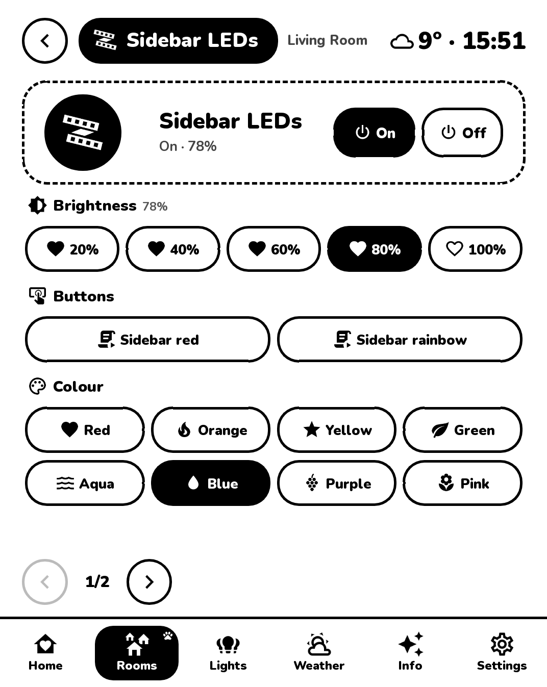

# PaperKiosk

**Home Assistant on an e-ink screen.** PaperKiosk turns a jailbroken Kindle (or any old tablet with a browser)
into a calm, always-on control panel for your home: lights, climate, TV, scenes, the weather, bin day, and a
little cat who comments on all of it. (=^.^=)

<p>



</p>

- **Made for e-ink.** Black and white, big touch targets, one screen per page (no scrolling), and pages that
  redraw only what changed, so taps feel quick even on a 2015 Kindle.
- **Reads everything from Home Assistant.** Rooms are HA's areas; new devices show up by themselves (and wait
  for your approval first). Colours, effects, AC modes, TV sources: if HA can do it, the device page shows it.
- **Make it yours** on a settings page from your PC: which devices are on Home, nicknames, icons, the pet
  (cat, dog, bunny, robot, ...), brightness hearts or a slider, downtime hours, countdowns, more screens.
- **Safe by default.** Screens need a key to pair, settings need a password, other websites can't press your
  buttons, and unlocking doors or opening the garage is off until you allow it per device. See
  [SECURITY.md](SECURITY.md).

## What you need

- A computer that is always on, with **Docker** (a Raspberry Pi 4/5, a NAS, a mini PC, the machine that runs
  Home Assistant, ...). Linux or macOS.
- **Home Assistant** on your network.
- A screen:
  - a **Kindle** with a jailbreak and **KUAL** (see [docs/kindle.md](docs/kindle.md); tested on a Paperwhite 3,
    7th generation, firmware 5.14), ideally with **USBNetwork** too (then setup and updates are automatic), or
  - anything with a web browser: an old tablet or phone, an e-reader with a browser.

## Install

```sh
git clone https://github.com/CornillieJ/PaperKiosk.git
cd PaperKiosk
./install.sh
```

The installer walks you through it with menus and explains every step. Choose **Automatic** and it only asks
what it can't know (your Home Assistant token, a password, where the Kindle is). It:

1. checks Docker (and offers [gum](https://github.com/charmbracelet/gum) for the nice menus),
2. configures the server: port, address, time zone, the kiosk key and your settings password,
3. connects to Home Assistant: finds it, explains how to make an access token (with a separate user without
   admin rights), tests it, and asks which room the screen hangs in,
4. starts the server (`docker compose up -d`),
5. puts the app on the Kindle, over USB or Wi-Fi (or shows the link for any other screen),
6. starts the kiosk on the Kindle: over Wi-Fi it does the taps for you; otherwise it asks for one tap
   (*KUAL → PaperKiosk → Start kiosk*) and waits until the Kindle shows up.

Every step is also a script you can run on its own, any time:

| Script | What it does |
| --- | --- |
| `scripts/00-requirements.sh` | Checks Docker, Compose and tools; offers gum |
| `scripts/10-configure.sh` | `.env`, kiosk key, settings password (`--new-password`, `--new-key`) |
| `scripts/20-home-assistant.sh` | Home Assistant address, token, the kiosk's room |
| `scripts/30-start-server.sh` | Builds and (re)starts the server, prints the links |
| `scripts/40-kindle-install.sh` | Copies the Kindle app (USB, Wi-Fi or a folder to copy yourself) |
| `scripts/50-kindle-setup.sh` | Starts the kiosk on the Kindle and checks it works |
| `scripts/update.sh` | Pulls the newest version, rebuilds, updates the Kindle app |

Unattended installs: `./install.sh --yes` with the answers as environment variables, for example
`ADMIN_PASSWORD=... HA_URL=http://192.168.1.20:8123 HA_TOKEN=... SCREEN=other ./install.sh --yes`
(the variable names are listed at the top of each script).

## Use

- **Settings:** `http://<server>:8100/config` from a PC or phone (log in with your password). A live preview of
  the Kindle screen sits on the right; drag the cards on Home to reorder them.
- **On the Kindle:** tap a card to switch it, the hearts for brightness, the round **…** for everything else.
  The Settings tab picks the home style, says where the kiosk hangs today, and has *Going to bed*.
- After the Kindle restarts: *KUAL → PaperKiosk → Start kiosk*.
- More screens? Add them under *Screens* on the settings page; each can have its own room, cards and pet.

## Files

```
docker-compose.yml   the server (built from ./server)
.env                 your settings for the server (made by the installer; see .env.example)
secrets/             Home Assistant token, kiosk key, password hash, Kindle SSH key (never commit these)
data/config.json     the dashboard's settings (what you change on /config)
server/              the Python server and its tests
kindle/extension/    the KUAL extension that runs on the Kindle
kindle/tools/        screenshot / tap / open-a-page helpers for working on the Kindle over SSH
scripts/             the install steps
docs/                Kindle notes, troubleshooting, development
```

## More

- [docs/kindle.md](docs/kindle.md): jailbreak pointers, what the Kindle app does, Kindle quirks
- [docs/troubleshooting.md](docs/troubleshooting.md): when something doesn't work
- [docs/development.md](docs/development.md): how it is built, tests, the demo server
- [SECURITY.md](SECURITY.md): what PaperKiosk protects, and what you should do

PaperKiosk is not affiliated with Amazon or Home Assistant. Jailbreaking your Kindle is at your own risk.
MIT licensed, see [LICENSE](LICENSE).
